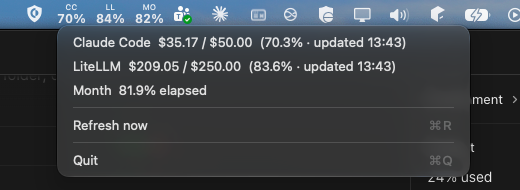

# AI Menu Bar

macOS menu bar item showing the Claude Code monthly credit, the LiteLLM budget and how much of the current month has elapsed:

```
 CC    LL    MO
21%    6%   15%
```

Each part has a small label on top and the percentage in bold below it.



- `CC`: Claude Code monthly credit used.
- `LL`: LiteLLM budget used.
- `MO`: share of the current calendar month that has elapsed, by time and not by whole days (for comparison with the other two). It needs no network or login.

Click it for the dollar amounts, the month progress, last update time and "Refresh now". Clicking one of the detail lines refreshes just that value. Everything refreshes every 5 minutes. `CC` and `LL` fail independently (a failed source shows `—`).

## Install on a Mac

```sh
git clone https://github.com/jeprubio/ai-menu-bar.git ~/ai-menu-bar && ~/ai-menu-bar/install.sh
```

`install.sh`:

1. Checks that `swiftc` is available (if not: `xcode-select --install`).
2. Asks for `LITELLM_BASE_URL` and `LITELLM_API_KEY` if they are missing from `~/.config/litellm/env`, and saves them there (`chmod 600`).
3. Checks that you are logged in to Claude Code (the app reads the login from the Keychain).
4. Builds `AIMenuBar.app`, registers it to launch at login and starts it.

It is safe to re-run, for example after editing `main.swift`.

## Requirements

- Xcode command line tools (`swiftc`).
- Logged in to Claude Code on this Mac, for the CC part.
- LiteLLM URL and API key, for the LL part.

## Configuration

The LiteLLM URL and API key are read from `~/.config/litellm/env`, outside the repo:

```sh
export LITELLM_BASE_URL='https://litellm.example.com'
export LITELLM_API_KEY='sk-...'
```

`install.sh` creates this file (`chmod 600`) if it is missing. To change the values later, edit the file and click "Refresh now"; the app re-reads it on every refresh. Never commit this file: it holds the API key.

The Claude Code part needs no configuration: it uses your Claude Code login from the Keychain.

## Other commands

| Command | What it does |
|---|---|
| `./build.sh` | Rebuild the app |
| `./run.sh` | Start the app |
| `./login-item.sh on \| off \| status` | Enable, disable or check launch at login |

## Notes

- The Claude Code figure comes from `https://claude.ai/api/oauth/usage`, an internal endpoint that is not a documented API, so it may change without notice.
- If Claude Code has not been opened for a long time, its login token can expire and CC shows `—` until you open Claude Code again.
